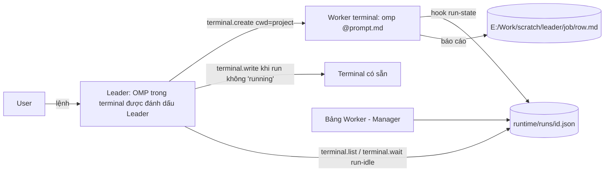

# Leader terminal: một OMP điều phối các terminal khác

- Ngày: 2026-10-29
- Trạng thái: đang triển khai
- Nguồn quyết định: phiên ak-advise 29/10 (user chốt: tự động hết kể cả Stage, không chắc → Pending + comment + báo Leader, theme live → dừng hỏi, Leader toàn quyền mọi terminal, terminal OMP + bảng Worker, số worker do Leader tự quyết). Phân tích nền: `plans/reports/261018-terminal-orchestrator-analysis.md`.

## Thiết kế

- Quyền Leader gắn vào **id terminal**. Id không bao giờ tái sử dụng (bộ đếm tăng dần, lưu đĩa) nên terminal mới không thừa hưởng quyền.
- Bật/tắt Leader chỉ từ UI (menu chuột phải hàng terminal). Agent không tự phong Leader được.
- Leader scope: list/write/wait/close mọi terminal còn sống trừ shell của chính nó; create terminal gốc trong project sở hữu `cwd` (cùng cách đặt chỗ như "terminal mới trong thư mục" của Manager).
- Chống gõ chèn: `terminal.write` của Leader bị từ chối `TERMINAL_BUSY` khi OMP đích đang `running` (trừ `force:true`). `waiting_user`/`idle` được ghi.
- `terminal.wait` thêm điều kiện `run-idle` đọc file run-state của hook OMP thay vì đoán từ text PTY.
- Giao việc ban đầu: Leader ghi prompt ra file rồi gõ `omp @<file>` trong worker. Không cần đổi hook OMP.
- Playbook (skill `antifan-leader`) mô tả quy trình feedback F1GENZ và các case khác.

## Tiêu chí nghiệm thu

- Id terminal/split đã đóng không bao giờ được cấp lại, kể cả qua lần khởi động lại.
- Terminal không phải Leader: hành vi `terminal.*` không đổi (test hiện có xanh).
- Leader: list thấy terminal của project khác kèm trạng thái run; create tạo terminal gốc trong đúng project; write vào terminal đang `running` bị từ chối; wait `run-idle` trả về khi OMP xong.
- Đóng terminal Leader thì quyền Leader mất; id mới không có quyền.
- Bảng Worker trong Manager hiện worker theo Leader, trạng thái run, bấm nhảy tới terminal.

## Ngoài phạm vi

Hook OMP mới, tự động git push/merge, `theme push` lên theme live không hỏi.
