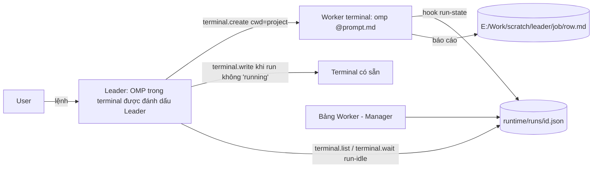

# Leader terminal: một OMP điều phối các terminal khác

- Ngày: 2026-10-29
- Nguồn quyết định: phiên ak-advise 29/10 (user chốt: tự động hết kể cả Stage, không chắc → Pending + comment + báo Leader, theme live → dừng hỏi, Leader toàn quyền mọi terminal, terminal OMP + bảng Worker, số worker do Leader tự quyết). Phân tích nền: `plans/reports/261018-terminal-orchestrator-analysis.md`.

## Thiết kế

- Quyền Leader gắn vào **id terminal**. Bộ đếm tăng dần lưu ở `terminal-id-counters.json` (và sàn từ file run + `leader-terminals.json`) để id không bị cấp lại. Daemon đang chạy bản cũ vẫn cấp lại id cho tới khi khởi động lại; trong lúc đó `terminal.create` của Leader xoá file run và cờ Leader còn sót của id mới sinh ra, và `terminal.list` báo `daemonOutdated`.
- Bật/tắt Leader chỉ từ UI (menu chuột phải hàng terminal). Agent không tự phong Leader được.
- Leader scope: list/write/wait/close mọi terminal còn sống trừ shell của chính nó; create terminal gốc trong project sở hữu `cwd` (cùng cách đặt chỗ như "terminal mới trong thư mục" của Manager).
- Chống gõ chèn: `terminal.write` của Leader bị từ chối `TERMINAL_BUSY` khi OMP đích đang `running` (trừ `force:true`). `waiting_user`/`idle` được ghi.
- `terminal.wait` thêm điều kiện `run-idle` đọc file run-state của hook OMP thay vì đoán từ text PTY.
- Giao việc ban đầu: Leader ghi prompt ra file rồi gõ `omp @<file>` trong worker. Hook OMP `antifan-edit-guard` giờ chặn lệnh theme từ xa trong worker (bash, eval, và dòng gõ qua `terminal.write` của worker); hook `run-state` giữ file run cho OMP gốc của terminal (subagent không ghi đè).
- Playbook (skill `antifan-leader`) mô tả quy trình feedback F1GENZ và các case khác.

## Tiêu chí nghiệm thu

- Id terminal/split đã đóng không bao giờ được cấp lại, kể cả qua lần khởi động lại. **Chưa kiểm chứng live** cho tới khi daemon được khởi động lại với bản mới; hiện chỉ được chứng minh bằng test đơn vị và e2e cô lập.
- Terminal không phải Leader: hành vi `terminal.*` không đổi (test hiện có xanh).
- Leader: list thấy terminal của project khác kèm trạng thái run; create tạo terminal gốc trong đúng project; write vào terminal đang `running` bị từ chối; wait `run-idle` trả về khi OMP xong.
- Đóng terminal Leader hoặc bỏ đánh dấu thì quyền Leader mất; id mới không có quyền. Worker của Leader đó giữ cổng chặn lệnh theme (thành worker mồ côi, hiện riêng trên Bảng Worker).
- Bảng Worker trong Manager hiện worker theo Leader, trạng thái run (đang chạy / chờ bạn / xong lượt / nghỉ / kết thúc / không phản hồi), bấm nhảy tới terminal; worker mồ côi nằm ở mục riêng. Xác nhận bằng mắt cần copy-static rồi reload cửa sổ (không có e2e cho bảng).

## Ngoài phạm vi

Tự động git push/merge, `theme push` lên theme live không hỏi, sandbox thật cho shell của worker (cổng chỉ là hàng rào cho lệnh viết thẳng tên CLI theme; xem CHANGELOG).
