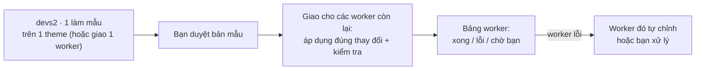

# Terminal điều phối (devs2 · 1 → worker S2): phân tích tiếp

- Thời điểm: 2026-10-18
- Phạm vi: chỉ phân tích, không sửa code, chưa chạy thử nghiệm.
- Đầu vào từ người dùng: tất cả worker chạy OMP; số worker 5–10; giữ các dây đã nối qua lần khởi động lại, cho nối và tháo tự do; hỏi cách này có hiệu quả khi ra cùng một lệnh cho 4–5 theme giống nhau không.

## Mục lục

1. Kết luận
2. Lỗ hổng mới phát hiện: tên terminal bị tái sử dụng
3. Giữ dây qua lần khởi động lại
4. 5–10 worker: chỗ nào chịu tải
5. Có hiệu quả cho 4–5 theme giống nhau không
6. Quy tắc "chờ bạn"
7. Việc tiếp theo
8. Câu hỏi còn mở
9. Nguồn

## 1. Kết luận

Phương án "trưởng nhóm giao việc qua hộp thư" vẫn đứng vững khi tất cả worker chạy OMP. Có ba điều chỉnh:

- **Mỗi terminal cần một mã danh tính riêng, không bao giờ dùng lại.** Hiện tại tên `terminal-N` được dùng lại sau khi đóng, nên nếu nối dây theo tên thì terminal mới mở sẽ thừa hưởng dây cũ (mục 2). Đây là điều kiện để giữ được dây qua lần khởi động lại.
- **Ra cùng một lệnh cho nhiều theme giống nhau:**
  - Nếu là cùng một thay đổi code, cách tốt nhất là **làm mẫu ở 1 theme, kiểm tra, rồi nhân bản thay đổi đó** sang các theme còn lại. Để 5–10 agent tự nghĩ lại từ đầu thì tốn gấp nhiều lần và mỗi bản ra một kiểu.
  - Hộp thư điều phối phát huy giá trị ở phần **kiểm tra song song trên từng storefront** và ở những theme cần chỉnh riêng (mục 5).
- **"Chờ bạn" vẫn do bạn trả lời.** Khi có 10 worker cùng hỏi một câu, cần nút "trả lời giống nhau cho tất cả" để bạn không phải bấm 10 lần (mục 6).

## 2. Lỗ hổng mới phát hiện: tên terminal bị tái sử dụng

Bằng chứng trong repo:

- `nextTerminalId()` lấy số trống nhỏ nhất: `while (this.sessions.has(\`terminal-${n}\`)) n++` (`src/main/browser/terminal-manager.ts:2088-2091`). Đóng `terminal-3` thì terminal mở kế tiếp lại tên `terminal-3`.
- Khi đóng terminal, bộ đếm thế hệ của tên đó bị xóa (`sessionGenerations.delete(id)` tại `terminal-manager.ts:2389, 3127`; bản split tại `2382, 2556, 3120`). Terminal mới cùng tên đếm lại từ thế hệ 1, nên cặp `(tên, thế hệ)` cũng trùng được.
- Ngoài tên ra, terminal không có mã định danh duy nhất nào khác: tìm `randomUUID` / `instanceId` trong `terminal-manager.ts` không ra kết quả nào.

Hậu quả nếu nối dây theo tên:

- Đóng `devs2 · 1` (giả sử tên nó là `terminal-3`). Một terminal không liên quan được mở sau đó nhận lại tên `terminal-3`, và nó sẽ thừa hưởng quyền điều phối 5–10 worker.
- Nếu "mã nhận diện" của bước xác thực được tính chỉ từ tên, terminal mới tính ra **đúng mã cũ**. Một process vẫn còn giữ mã cũ cũng tiếp tục hợp lệ.

Cách sửa:

- Khi tạo terminal, sinh một **mã danh tính ngẫu nhiên**, lưu cùng hồ sơ terminal trong `terminal-sessions.json`.
- Mã giữ nguyên khi terminal ngủ/thức, khởi động lại shell, hay khởi động lại AntiFan. Mã mất khi đóng terminal và không bao giờ được cấp lại.
- Dây nối và mã nhận diện (`HMAC(khóa trên đĩa, mã danh tính)`) đều gắn với mã này, không gắn với tên.
- Đóng terminal điều phối thì mọi dây của nó tự hủy. Đây là một tiêu chí nghiệm thu bắt buộc.

Một lưu ý về xác thực: dây do bạn nối chỉ quyết định **ai được phép** ra lệnh. Nó không chứng minh **ai đang gọi**. Chính mã nhận diện nằm trong môi trường của `devs2 · 1` mới gắn người gọi với đúng terminal đó. Vì vậy không bỏ mã nhận diện được, kể cả khi đã có dây do người dùng nối. Mã này vẫn không chống được phần mềm độc hại cùng user trên Windows (đọc được bộ nhớ process khác); nó chỉ chặn việc đoán hoặc mượn tên.

## 3. Giữ dây qua lần khởi động lại

Theo yêu cầu của bạn, dây được lưu xuống đĩa, gắn theo mã danh tính ở mục 2. Khi mở lại AntiFan:

- **Terminal còn sống:** daemon giữ PTY qua lần khởi động lại Main, nên mã danh tính và mã nhận diện vẫn khớp. Dây hoạt động ngay.
- **Terminal đã đóng:** dây hiện mờ với nhãn "worker không còn". Bạn tháo hoặc nối sang terminal khác.
- **Worker bị chuyển sang project khác:** dây tự tháo, để quyền không đi theo terminal sang chỗ mới.
- **Phiên OMP trong worker được mở lại (mã phiên OMP đổi):** không ảnh hưởng. Mỗi lần giao việc, hệ thống tra phiên OMP hiện tại từ file trạng thái của terminal.

## 4. 5–10 worker: chỗ nào chịu tải

| Hạng mục | Ảnh hưởng khi lên 10 worker | Xử lý |
|---|---|---|
| Chi phí token | Mỗi worker là một agent riêng; Anthropic đo được agent tốn khoảng 4× token so với chat, hệ nhiều agent khoảng 15× | Dùng cách "làm mẫu rồi nhân bản" (mục 5) để worker chỉ áp dụng và kiểm tra, không nghĩ lại từ đầu |
| Giới hạn tốc độ của nhà cung cấp model | 10 phiên OMP gọi API cùng lúc có thể bị giới hạn [INFERENCE: chưa đo trên tài khoản của bạn] | Giao việc theo đợt (ví dụ 3–4 worker một lúc), các worker còn lại xếp hàng |
| Ngữ cảnh của trưởng nhóm | 10 báo cáo dài có thể làm đầy ngữ cảnh của `devs2 · 1` | Mỗi báo cáo ngắn (≤ 500 ký tự + số file đã sửa); chi tiết nằm ở worker |
| Máy của bạn | 10 OMP + các watcher `hrv theme dev` chạy cùng lúc tốn RAM/CPU [INFERENCE] | Giao theo đợt như trên |
| Giao diện | Chip `⇉ 10 worker`; bảng worker 10 dòng | Bảng có dòng tổng (đang chạy / chờ bạn / xong / lỗi) và nút "chỉ hiện dòng cần chú ý" |

## 5. Có hiệu quả cho 4–5 theme giống nhau không

Câu trả lời phụ thuộc vào loại lệnh.

| Loại lệnh | Ví dụ | Cách hiệu quả nhất | Vai trò của điều phối |
|---|---|---|---|
| Cùng một thay đổi code trên các theme chung bộ mã | Sửa lỗi header, thêm một section, đổi CSS | **Làm mẫu → nhân bản:** sửa 1 theme, kiểm tra, xuất thay đổi, áp dụng sang các theme còn lại | Worker nhận lệnh "áp dụng đúng thay đổi này rồi kiểm tra storefront của bạn"; chỉ worker nào áp dụng lỗi mới phải tự xử lý |
| Cùng một nhiệm vụ nhưng mỗi theme khác dữ liệu | QA từng storefront, cập nhật nội dung theo từng shop, chỉnh theo settings riêng | **Giao song song qua hộp thư** | Phát huy tối đa: mỗi worker có ngữ cảnh project, tab trình duyệt và watcher của riêng nó |
| Lệnh shell giống hệt nhau | `git status`, đóng gói theme | Không cần agent; trưởng nhóm tự chạy theo từng thư mục (đúng như vòng lặp Python trong ảnh) | Không cần |

Lý do không nên để 5–10 agent tự nghĩ lại cùng một thay đổi:

- **Chi phí** nhân lên theo số worker (mục 4).
- **Kết quả không đồng nhất:** cùng một prompt, các agent có thể đi những con đường khác nhau. Anthropic ghi nhận điều này ngay cả khi điểm xuất phát giống hệt. Với các theme lẽ ra phải giống nhau, code dần lệch nhau theo thời gian.
- **Lập trình ít khi song song được hoàn toàn:** Anthropic cũng nhận xét đa số tác vụ code có ít phần thực sự song song được.

Quy trình đề xuất cho các theme giống nhau:

Điểm cần kiểm chứng trước [INFERENCE]: các theme S2 có thật sự chung bộ mã đến mức một bản thay đổi áp dụng thẳng được không. Nếu mỗi theme đã chỉnh riêng nhiều thì tỉ lệ áp dụng lỗi tăng, và cách giao song song để từng worker tự chỉnh sẽ có lợi hơn.

## 6. Quy tắc "chờ bạn"

"Chờ bạn" là lúc OMP trong một worker **dừng lại hỏi ý kiến**: một câu hỏi lựa chọn, hoặc một xác nhận trước thao tác nhạy cảm. Ví dụ: "Xóa 3 file cũ trong `assets/` không?".

Đề xuất:

- **Chỉ bạn trả lời.** `devs2 · 1` được biết worker đang chờ nhưng không được tự bấm thay. Nếu không, mọi câu hỏi xác nhận của OMP đều có thể bị agent khác bấm qua.
- **Nút "trả lời giống nhau cho tất cả":** khi nhiều worker cùng chờ một câu hỏi giống nhau, bảng worker gom chúng thành một nhóm để bạn trả lời một lần. Câu trả lời vẫn do bạn bấm.
- **Giảm số câu hỏi ngay từ đầu:** phiếu việc nên ghi rõ phạm vi được tự quyết (ví dụ "được sửa file trong `sections/`, không xóa file"). Khi đó worker ít phải dừng lại hỏi.

## 7. Việc tiếp theo

1. Thử nghiệm nhỏ (cần bạn duyệt, vì nó sửa hook OMP mà các phiên OMP đang chạy dùng chung): cho hộp thư nhận phiếu việc khi OMP đang nghỉ, rồi kiểm tra cách lấy câu trả lời cuối khi OMP chạy xong.
2. Kiểm tra mức chung code giữa các theme S2 để quyết định "nhân bản thay đổi" hay "giao song song" là mặc định.
3. Lập kế hoạch triển khai: mã danh tính terminal, dây nối lưu trên đĩa, hộp thư giao việc, báo cáo, giao theo đợt, bảng worker, nút trả lời chung.

Tiêu chí nghiệm thu bổ sung so với bản trước:

- Đóng terminal điều phối thì mọi dây của nó tự hủy. Terminal mới trùng tên không có quyền gì.
- Mã nhận diện của terminal đã đóng bị từ chối.
- Khởi động lại AntiFan: dây của các terminal còn sống vẫn hoạt động; dây của terminal đã đóng hiện trạng thái "worker không còn".
- Với 10 worker, số worker chạy đồng thời không vượt mức giới hạn đã đặt.

## 8. Câu hỏi còn mở

1. Các theme S2 chung bộ mã đến mức nào (cùng base, chỉ khác settings và nội dung, hay đã chỉnh riêng nhiều)?
2. Mỗi đợt chạy đồng thời tối đa bao nhiêu worker là phù hợp với tài khoản model và máy của bạn?

## 9. Nguồn

- Anthropic, "How we built our multi-agent research system" (2025-06-13): https://www.anthropic.com/engineering/multi-agent-research-system. Mô hình orchestrator–worker; khoảng 15× token so với chat; agent đi đường khác nhau dù cùng điểm xuất phát; tác vụ code ít phần song song thật.
- Claude Code docs, "Run agents in parallel": https://code.claude.com/docs/en/agents.md. Các cách chạy nhiều tác vụ song song.
- Repo AntiFan: `src/main/browser/terminal-manager.ts:895, 1597, 1779, 2088-2091, 2382-2389, 3120-3127`; `src/omp-hooks/run-state.ts:408-436`.
