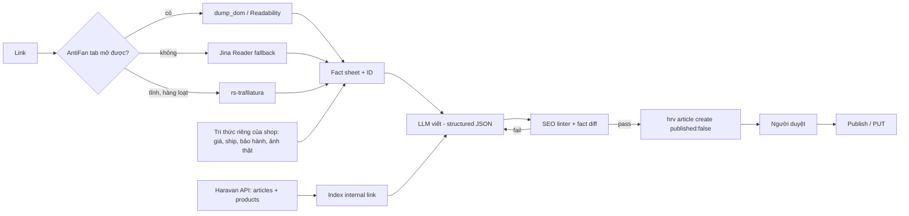
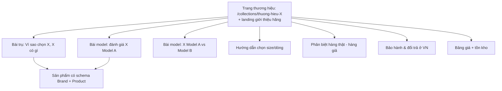

# Link → AI đọc → viết lại chuẩn SEO → Haravan: khả thi không, và dùng công nghệ gì

**Thời điểm khảo sát:** 2026-11-14 (bổ sung kịch bản "thương hiệu nhập về bán")
**Bối cảnh:** AntiFan (Electron/Chromium harness) đã có browser thật + Haravan CLI (`hrv`) + gateway LLM nội bộ.

Nhãn bằng chứng: **[DOC]** = đọc trực tiếp docs.chavan.com; **[CODE]** = đọc source trong `E:/Work/apps/Haravan CLI`; **[INFERENCE]** = suy luận, chưa chạy; **[3RD]** = nguồn thứ ba, chưa xác minh lại.

---

## 0. Kết luận trước (TL;DR)

**Khả thi kỹ thuật: CÓ, ~2–4 ngày cho bản chạy được trong stack hiện tại. Khả thi SEO: CÓ ĐIỀU KIỆN.**

Ba câu cần nói thẳng:

1. **"Đọc toàn bộ rồi viết lại" là mẫu rủi ro nhất.** Google không phạt nội dung AI, phạt nội dung không có người chịu trách nhiệm và sản xuất hàng loạt để chiếm thứ hạng (*scaled content abuse*). [3RD] — mức độ chắc chắn trung bình: các nguồn tổng hợp đều nói vậy, nhưng phần lớn không mở được trang gốc của Google và các con số sụt traffic là số của blog SEO, không phải số Google công bố.
2. **Giá trị không nằm ở chỗ "viết", nằm ở chỗ "chặn đăng bài dở".** Phần LLM viết là 20% công; 80% còn lại là: chốt fact sheet, kiểm số liệu, linter SEO tất định, nháp `published:false` + người duyệt.
3. **Haravan blog một mình gần như không lên top.** Không internal link từ sản phẩm/collection, không trang tác giả, không cập nhật định kỳ thì bài sạch cỡ nào cũng nằm im.

Với trường hợp **thương hiệu nhập về bán** (mục 6), giá trị nội dung gần như 100% nằm ở phần *bạn biết mà hãng không nói*: giá bán thực tế, thời gian giao, bảo hành ở VN, phân biệt hàng thật/giả, cách chọn size/model. Đó cũng là phần duy nhất LLM không bịa được — và là phần quyết định bài có xếp hạng hay không.

---

## 1. Điều đã kiểm chứng trong repo/hạ tầng hiện tại

| Hạng mục | Trạng thái | Bằng chứng |
|---|---|---|
| Đẩy bài lên Haravan | **Đã có sẵn** | **[CODE]** `Haravan CLI/src/helper/resource-registry.ts:96` khai báo resource `article`, path `blogs/{blog}/articles`; header `src/commands/resource.ts` ghi mẫu `hrv article list --blog <blog_id>` |
| Cú pháp lệnh | **Đã xác nhận** | **[CODE]** dạng `<resource> <action>`: `hrv article create --blog <blog_id> --data @payload.json` |
| Schema API article | **Đã xác nhận** | **[DOC]** `POST /web/blogs/{blog_id}/articles.json`, scope `com.read_contents` / `com.write_contents` |
| Article có metafields | **Đã xác nhận** | **[DOC]** `/web/blogs/{id}/articles/{id}/metafields.json` nằm trong danh sách resource hỗ trợ metafield |
| Khoá metafield SEO của Haravan admin | **Chưa xác nhận** | Chưa biết Haravan admin lưu SEO title/description vào namespace/key nào → phải probe |
| Browser để crawl (JS + anti-bot) | **Đã có sẵn** | AntiFan MCP: `anti.browser.dump_dom`, `anti.inspect.page_inventory`, `anti.reference.capture`, `anti.screenshot.full_page` |
| Gateway LLM | **Đã có (ngoài AntiFan)** | 9router/AI Box; trong AntiFan chưa có client LLM nào |
| Extraction lib trong repo | **Chưa có** | Không có `readability`/`turndown`/`cheerio`; có `jsdom ^29` (đủ chạy Readability) |

---

## 2. Công nghệ nên dùng (và loại bỏ)

### 2.1 Lấy nội dung từ link

| Lựa chọn | Đo được [3RD] | Quyết định |
|---|---|---|
| **AntiFan tab (CDP) + `@mozilla/readability` trên jsdom** | Site đã đăng nhập, qua được JS/anti-bot; Readability ~0.887–0.94 F1 trên bộ ScrapingHub | **Chọn chính.** Zero chi phí API, tái dùng đúng thứ đã có |
| Trafilatura (bản Rust) | F1 0.966 trên ScrapingHub, 0.859 trên WCXB, 44 ms/trang, CPU | Fallback offline khi crawl số lượng lớn HTML tĩnh. Không render JS, hay bị block |
| Jina Reader | 500 req free, breadth tốt (PDF, YouTube), 0.8–2.9 s | Fallback nhanh khi không mở được tab; còn boilerplate |
| Firecrawl | Precision thấp hơn Trafilatura khi so trực tiếp (0.785 vs 0.955), ~33% thành công trên site chống bot | **Loại.** Trả tiền cho thứ AntiFan đã có |

Trang sản phẩm/collection là nơi mọi extractor đều yếu (F1 0.670 và 0.713 trên WCXB [3RD]). Nếu link đầu vào là PDP/collection, đừng đưa HTML thô cho LLM; đọc theo schema `/products/<handle>.js` hoặc `theme.resolve_product`.

### 2.2 Viết

- Gateway sẵn có, bắt buộc **structured output** theo JSON Schema:
  `{ title, slug, meta_description, outline[], body_html, faq[], tags[], image_alts[], internal_links[{anchor,url}], facts_used[] }`
- **Không có benchmark công khai nào đo viết bài dài tiếng Việt chuẩn SEO.** Các benchmark tiếng Việt hiện có (V-Bench 07/2026, VMLU, VIVID, VialectBench) đo kiến thức/ngữ nghĩa/phương ngữ. Các so sánh "model nào viết tiếng Việt hay" đều là blog marketing, mâu thuẫn, dẫn cả model đời cũ. [3RD]
- Hệ quả: **tự bench 3–5 URL thật của chính shop, chấm mù.** Tiêu chí: đúng số từ (lỗi phổ biến: yêu cầu 400 từ → ra 180–250), H2/H3 đúng cấp, tiếng Việt không "mùi AI", số liệu khớp fact sheet, giữ mạch trên 2.000 từ.

### 2.3 Kiểm soát chất lượng (phần quan trọng nhất)

1. **Fact sheet trước, viết sau.** Pass 1 chỉ trích *dữ kiện* (số, tên, giá, ngày, trích dẫn) thành danh sách có ID. Pass 2 viết bài bắt buộc gắn `facts_used[]`. Pass 3 diff số liệu: mọi con số trong bài phải có trong fact sheet; sai một số là fail.
2. **Linter SEO tất định** (code, không LLM): 1 H1; từ khóa trong 100 từ đầu; 4–8 H2; số internal link theo độ dài (2–5/1.000 từ); meta title ≤ 60 ký tự; meta description 140–160; slug không dấu ≤ 60 ký tự; alt cho mọi ảnh; ngày đăng/ngày cập nhật; block FAQ + JSON-LD `FAQPage`.
3. **Nháp `published: false` + người duyệt.** Không có đường auto-publish.

### 2.4 Đăng lên Haravan

**[DOC]** payload tạo bài (ảnh remote được Haravan tự tải về, hoặc base64):

```json
{ "article": { "title": "...", "author": "...", "tags": "a, b",
  "body_html": "...", "summary_html": "...", "handle": "slug-khong-dau",
  "image": { "src": "https://..." } } }
```

Lệnh ( **[CODE]** dạng `<resource> <action>`, registry có `article` + path `blogs/{blog}/articles` ):

```bash
hrv article create --blog <blog_id> --data @payload.json
hrv article update <article_id> --blog <blog_id> --data @payload.json
```

**Nháp hay publish:** **[DOC]** article có property `published: boolean` ("States whether or not the article is visible"), và `published_at`. Docs chỉ cho ví dụ create có `published_at`; docs Pages mới có mục "create a new, but unpublished page". Vì vậy cách ra nháp của article là **[INFERENCE] chưa chạy thử**: bỏ `published_at` và gửi `"published": false`. **Đừng đặt `published: false` cùng `published_at` có giá trị** — mâu thuẫn, hành vi chưa biết. Phải probe bằng 1 bài nháp trên shop thật trước khi build.

**SEO meta:** **[DOC]** article có metafields, nhưng chưa biết Haravan admin dùng namespace/key nào cho SEO title/description. **[INFERENCE]** khả năng cao là một cặp `global`/`title_tag`–`description_tag` kiểu Shopify, nhưng **không được suy từ Shopify**. Probe: tạo 1 bài, điền SEO trong admin, GET metafields, đọc ra key thật. Nếu không đẩy được: theme tự sinh meta description từ `summary_html` cắt 160 ký tự + tự dựng JSON-LD `BlogPosting`.

---

## 3. Kiến trúc tối thiểu



- **AntiFan** (đã có): fetch + extract + dedupe ảnh.
- **Script Node** (mới, ~300–500 dòng): fact sheet → prompt → validate → `hrv` push. Không cần đụng Electron main.
- **Haravan theme**: JSON-LD + meta fallback + breadcrumb.

---

## 4. Rủi ro phải chấp nhận hoặc chặn

| Rủi ro | Mức | Cách chặn |
|---|---|---|
| Bị xếp *scaled content abuse* nếu đăng hàng loạt [3RD] | Cao | Nháp + duyệt tay; ≤ 1–2 bài/ngày; mỗi bài có ≥ 1 dữ kiện riêng |
| Bản quyền: viết lại nguyên bài người khác | Cao | Nguồn là *research*, không phải *bản gốc để paraphrase*. Đổi góc, thêm dữ kiện riêng, không copy cấu trúc mục 1:1, không copy ảnh |
| Dùng ảnh/mô tả của hãng | Cao | Hotlink hoặc copy ảnh hãng = rủi ro bản quyền; dùng ảnh tự chụp + ảnh press-kit có phép |
| Ảo giác số liệu / tên sản phẩm | Cao | Fact sheet + diff số + trích nguồn trong draft |
| "Chuẩn SEO" nhưng không lên top | Trung bình | Internal link + author page + cập nhật định kỳ; đo bằng Search Console 8–12 tuần |
| Haravan không nhận SEO meta | Trung bình | Probe metafield trước; nếu không, xử lý ở theme |
| Prompt "viết 400 từ" ra 180 từ | Chắc chắn | Linter đếm từ theo section, fail là retry |

---

## 5. Việc nên làm, theo thứ tự

1. Probe 2 thứ trên shop thật, 30 phút: (a) tạo bài nháp không `published_at` → kiểm tra đúng là ẩn; (b) điền SEO title/description trong admin → GET metafields → chốt key.
2. Viết script `url → extract → fact sheet → generate → lint → hrv article create` cho **một** bài, chạy tay 3 lần, đọc kỹ output.
3. Bench model trên 3–5 URL thật, chấm mù, người Việt duyệt cuối.
4. Ổn rồi mới thêm internal-link index từ Haravan articles/products và linter đầy đủ.
5. Giữ đúng một nút bấm nhưng kết thúc ở **draft**, không bao giờ ở publish.

---

## 6. Kịch bản: viết bài cho thương hiệu nhập về bán

Đây khác hoàn toàn "viết lại bài blog người khác", và dễ ăn hơn nhiều.

### 6.1 Vấn đề cốt lõi

Mô tả sản phẩm và thông tin kỹ thuật trên site hãng **đã được index**. Viết lại chúng = nội dung trùng lặp, và bạn cạnh tranh trực tiếp với chính chủ thương hiệu — người luôn thắng ở tín hiệu thực thể (entity). Vì vậy **không lấy nguồn là "bài viết của hãng"**; lấy nguồn là **trang thông số chính thức** để *kiểm chứng*, còn nội dung là phần **bạn bán hàng thật mới biết**.

### 6.2 Cấu trúc nội dung nên làm (thay vì bài blog rời)



- 1 trang hub thương hiệu (collection/landing) là **đích của mọi internal link**; đây là thứ lên top, blog chỉ phụ.
- Mọi bài phải trỏ về ít nhất 1 PDP và ngược lại PDP/collection trỏ về hub.

### 6.3 Dữ kiện riêng bắt buộc có trong mỗi bài (fact sheet, người nhập)

| Trường | Nguồn | Vì sao |
|---|---|---|
| Giá bán thực tế + giá niêm yết | Shop | Không LLM nào biết |
| Thời gian giao, khu vực, phí ship | Vận hành | Tín hiệu trải nghiệm |
| Chính sách bảo hành, đổi trả, ai bảo hành | Vận hành | Câu hỏi chặn mua lớn nhất |
| Hàng chính hãng: hoá đơn, tem, cách kiểm | Vận hành | Yếu tố niềm tin, E-E-A-T |
| Tồn kho / size còn | POS/Haravan | Chống mô tả sai |
| Ảnh thật, video mở hộp | Tự chụp | Không copy ảnh hãng |
| Tên pháp nhân + uỷ quyền phân phối (nếu có) | Giấy tờ | Chỉ claim "chính hãng/phân phối" khi có giấy |

**Quy tắc:** trường nào trống thì bài không được publish. Đây là cơ chế chặn nội dung rỗng chắc chắn hơn mọi prompt.

### 6.4 Ràng buộc pháp lý / thương hiệu

- Chỉ ghi "nhà phân phối chính hãng / đại lý uỷ quyền" khi có giấy uỷ quyền; không có thì ghi "shop nhập khẩu và bán lẻ".
- Dùng tên thương hiệu + model để mô tả hàng hoá là bình thường; dùng logo/nhận diện của hãng làm nhận diện shop thì không.
- Thông tin sản phẩm, giá, bảo hành phải hiển thị rõ trên trang bán (yêu cầu thông tin cho website thương mại điện tử — Nghị định 52/2013/NĐ-CP, sửa đổi bởi 85/2021/NĐ-CP). Đây là lý do nội dung "chính sách" vừa có tác dụng SEO vừa là nghĩa vụ.

### 6.5 Pipeline áp cho kịch bản này

1. Nhập `brand_url` (trang thông số/collection của hãng) → extract bằng AntiFan tab + Readability → **chỉ dùng làm fact sheet kỹ thuật**.
2. Trộn fact sheet shop (bảng 6.3) + fact sheet hãng → chọn 1 angle chưa ai viết (bảo hành ở VN, so sánh 2 model cùng tầm giá, hướng dẫn chọn theo nhu cầu).
3. LLM viết theo angle đó, không theo cấu trúc trang hãng; cấm dùng câu nào trùng quá N-gram với nguồn (thêm bước shingle check).
4. Linter + fact diff + kiểm "≥ 3 dữ kiện riêng của shop" → draft → duyệt → publish.

---

## 7. Câu chưa có đáp án

- Haravan admin lưu SEO title/description của article vào namespace/key nào? Chưa xác nhận — cần probe (mục 2.4).
- `published: false` + không `published_at` có ra nháp đúng không, hay article vẫn publish? Chưa chạy thử.
- Blog id mặc định và số bài hiện có của shop? Cần token shop cụ thể.
- Model nào trong gateway viết tiếng Việt tốt nhất? Không có benchmark công khai — phải tự đo.

---

## Nguồn

- Haravan Article API — https://docs.haravan.com/docs/omni-apis/articles/
- Haravan Metafield API — https://docs.haravan.com/docs/omni-apis/metafield/
- WCXB benchmark (05/2026) — https://arxiv.org/pdf/2605.21097
- ScrapingHub article benchmark qua robertz.co — https://robertz.co/knowledge/computer-science/ai-llm-engineering/web-scraper-extraction-quality/
- KrabArena: Jina vs Firecrawl vs Trafilatura — https://krabarena.com/battles/which-markdown-reader-wins-jina-vs-firecrawl-vs-spider-vs-trafilatura
- Scaled content abuse — https://ppc.land/scaled-content-abuse/ ; https://www.stanventures.com/news/7-google-spam-updates-later-where-seo-stands-in-2026-7573/
- Google October 2026 AI content guidance — https://searchatlas.com/blog/google-october-2026-ai-content-guidance-update/
- E-E-A-T 2026 — https://webwise.digital/blog/eeat-2026-complete-guide-google-quality-rater-guidelines
- V-Bench (VinUni, 07/2026) — https://vinuni.edu.vn/vinuniversity-launches-v-bench-an-ai-capability-benchmark-tailored-for-vietnamese/
